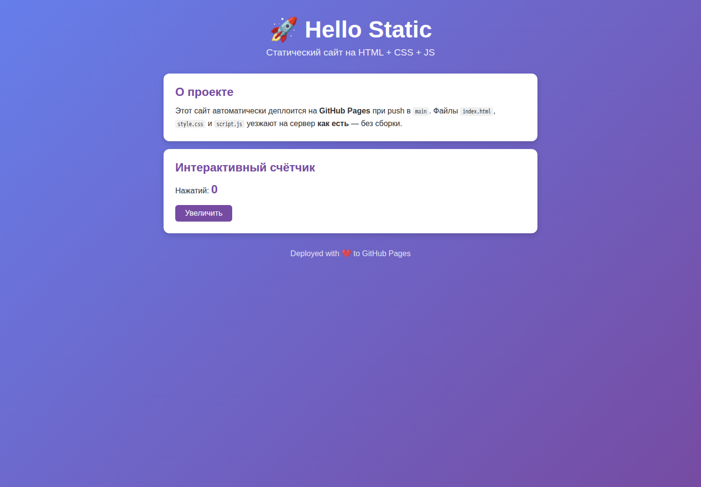

# Лабораторная работа: Static Site — CI/CD GitHub Pages

## Цель работы

Развернуть чистый статический сайт HTML/CSS/JavaScript на GitHub Pages через настоящий CI/CD: сначала обязательная валидация, затем автоматический deploy только при успешном `ci`.

Оригинальное задание: [CI/CD статического сайта на GitHub Pages](https://github.com/rurewa/imfua/blob/main/content/DevOps/CI_CD/Pipelines/CI_CD_static_site_Deploy.md).

## Использованные технологии

- HTML5, CSS и JavaScript без этапа сборки;
- Node.js 20 и npm;
- `html-validate`, Stylelint и ESLint;
- Playwright/Chromium для функциональной проверки;
- Nginx Alpine для локального просмотра;
- GitHub Actions, Artifacts, Environments и GitHub Pages.

## Реализация

Папка `public/` содержит готовый к публикации сайт с относительными путями `./style.css`, `./script.js` и `./favicon.svg`. Кнопка «Увеличить» изменяет интерактивный счётчик. Макет адаптируется к узкому экрану и имеет видимый фокус клавиатуры.

Workflow разделён на два независимых job:

1. `ci` выполняет `npm ci`, последовательно проверяет HTML, CSS и JavaScript, затем передаёт `public/` как артефакт.
2. `deploy` имеет `needs: ci`, получает артефакт и публикует его в окружение `github-pages`. Для pull request deploy не выполняется.

Поддерживаются push в `main`, pull request и ручной `workflow_dispatch`. Права разделены: `contents: read` для CI, `pages: write` и `id-token: write` только для deploy.

## Структура проекта

```text
hello-static/
├── .github/workflows/ci-cd.yml
├── public/
│   ├── favicon.svg
│   ├── index.html
│   ├── script.js
│   └── style.css
├── screenshots/
│   └── site-local.png
├── tests/site.spec.js
├── .gitignore
├── .htmlvalidate.json
├── .stylelintrc.json
├── eslint.config.js
├── package-lock.json
├── package.json
├── playwright.config.js
└── README.md
```

## Команды запуска и проверки

Чистая установка и линтеры в Node.js 20:

```powershell
docker run --rm `
  -e HOME=/tmp `
  -v "${PWD}:/app" `
  -w /app `
  node:20-alpine npm ci

docker run --rm `
  -e HOME=/tmp `
  -v "${PWD}:/app" `
  -w /app `
  node:20-alpine npm run lint
```

Локальный просмотр:

```powershell
docker run --rm -p 8081:80 `
  -v "${PWD}/public:/usr/share/nginx/html:ro" `
  nginx:alpine
```

После запуска сайт доступен по адресу `http://localhost:8081/`.

Функциональный браузерный тест проверяет заголовок и изменение счётчика с 0 на 1. Команда использует официальный образ Playwright той же версии, что указана в `package-lock.json`:

```powershell
docker run --rm --ipc=host `
  --add-host=hostmachine:host-gateway `
  -e BASE_URL=http://hostmachine:8081 `
  -v "${PWD}:/app" `
  -w /app `
  mcr.microsoft.com/playwright:v1.64.0-noble `
  npm run test:e2e
```

## Реальные результаты

- `npm ci`: 236 пакетов проверено, 0 уязвимостей;
- `html-validate`: успешно;
- Stylelint: успешно;
- ESLint: успешно;
- Playwright: 1 тест успешно, счётчик меняется с 0 на 1;
- Nginx: главная страница отдаётся по HTTP и корректно отображается;
- первый GitHub Actions job `ci`: [успешно выполнен](https://github.com/Andrey76546/hello-static/actions/runs/40294163354/job/121476043484);
- GitHub Pages deploy требует включить Source = GitHub Actions в настройках репозитория, после чего workflow необходимо запустить повторно.

## Скриншот



## Соответствие требованиям преподавателя

| Требование преподавателя | Реализация | Способ проверки | Результат |
|---|---|---|---|
| Чистый HTML/CSS/JS без сборки | Файлы находятся в `public/` | Локальный Nginx | Выполнено |
| Относительные пути | `./style.css`, `./script.js`, `./favicon.svg` | HTML validation и браузер | Выполнено |
| Обязательный `package-lock.json` | Зафиксирован в Git | `npm ci` | Выполнено |
| Валидация HTML | `html-validate` | `npm run lint:html` | Успешно |
| Валидация CSS | Stylelint | `npm run lint:css` | Успешно |
| Валидация JavaScript | ESLint | `npm run lint:js` | Успешно |
| Рабочий интерактивный счётчик | `script.js` | Playwright click/assert | 1 тест успешно |
| Передача `public/` между job | upload/download artifact | GitHub Actions job `ci` | Успешно |
| Deploy только после CI | `needs: ci` | Проверка workflow | Настроено |
| GitHub Pages environment | `environment: github-pages` | Deploy job | Ожидает включения Pages |
| Минимальные permissions | Раздельные job permissions | Проверка workflow | Выполнено |
| Защита параллельных deploy | `concurrency: pages` | Проверка workflow | Выполнено |

## Вывод

Исходный сайт, локальная публикация, линтеры, браузерный тест и CI подтверждены. Для завершения CD владелец репозитория должен один раз выбрать GitHub Actions как источник Pages и повторно запустить workflow.
